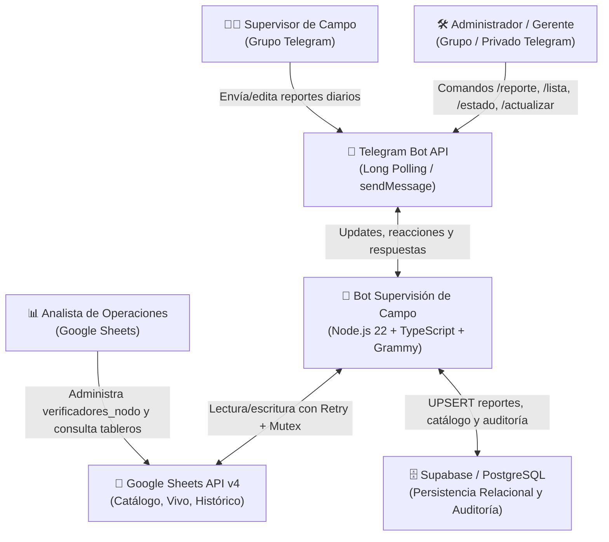
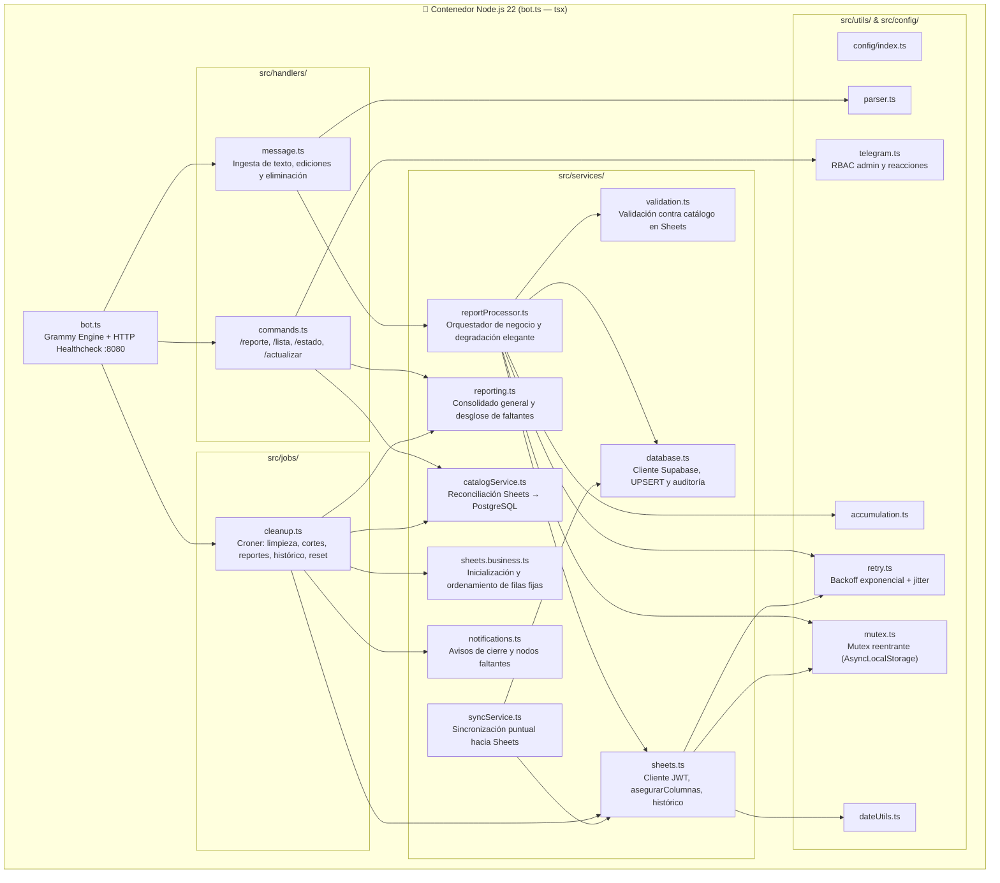
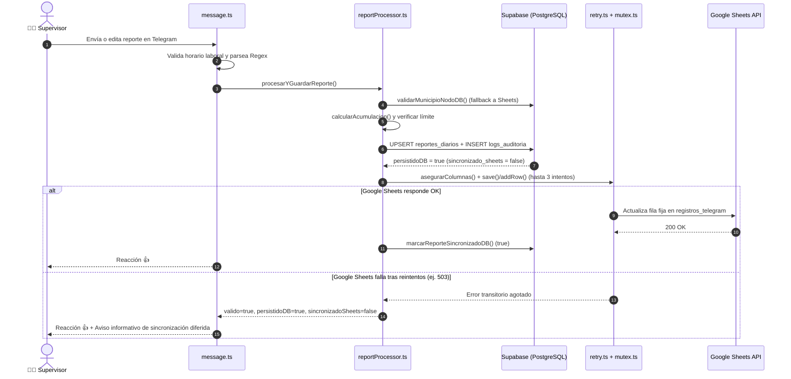
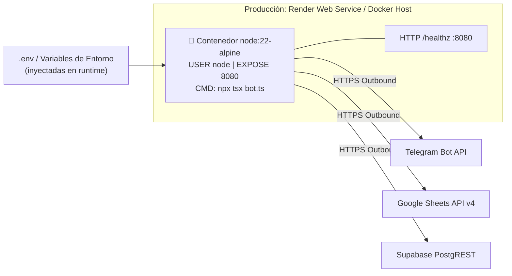

# 🏗️ Arquitectura General del Sistema

Este documento describe la arquitectura técnica, diagramas C4, componentes reales, flujos clave, topología de despliegue y decisiones arquitectónicas (ADRs) del **Bot de Telegram para Supervisión de Campo (`bot-telegram-campo`)** con persistencia dual (**PostgreSQL/Supabase + Google Sheets**).

---

## 1. Diagrama C4 — Nivel 1: Contexto del Sistema

---

## 2. Diagrama C4 — Nivel 2: Contenedores y Módulos Internos

---

## 3. Componentes Principales y Responsabilidades

| Capa                  | Archivo Real                                                                               | Responsabilidad                                                                                                                                                                              |
| :-------------------- | :----------------------------------------------------------------------------------------- | :------------------------------------------------------------------------------------------------------------------------------------------------------------------------------------------- |
| **Bootstrap & HTTP**  | `bot.ts`                                                                                   | Inicializa Grammy, registra handlers, levanta servidor HTTP (`GET /`, `GET /healthz`), maneja conflictos `409`, señales `SIGINT`/`SIGTERM` y secuencia de arranque.                          |
| **Configuración**     | `src/config/index.ts`                                                                      | Carga `.env` vía `dotenv/config`, valida `TELEGRAM_BOT_TOKEN` y centraliza zona horaria (`America/Caracas`), cortes `[9, 14, 18]` y horarios laborales.                                      |
| **Handlers**          | `src/handlers/message.ts`, `src/handlers/commands.ts`                                      | Recepción de `message:text` y `edited_message:text`, control de ventana laboral, eliminación por palabra clave y comandos administrativos protegidos.                                        |
| **Procesamiento**     | `src/services/reportProcessor.ts`, `src/utils/accumulation.ts`, `src/utils/parser.ts`      | Parseo regex, cálculo de bloque activo, acumulación con regla de pasado bloqueado, validación contra catálogo y persistencia dual con degradación elegante.                                  |
| **Google Sheets**     | `src/services/sheets.ts`, `src/services/sheets.business.ts`, `src/services/syncService.ts` | Autenticación JWT de cuenta de servicio, `asegurarColumnas`, reseteo de filas, resguardo histórico, inicialización y ordenamiento de filas fijas.                                            |
| **Base de Datos**     | `src/services/database.ts`, `src/services/catalogService.ts`                               | Cliente singleton de Supabase (`@supabase/supabase-js`), validación de catálogo, `UPSERT` en `reportes_diarios`, inserción en `logs_auditoria` y reconciliación del catálogo.                |
| **Reportes y Avisos** | `src/services/reporting.ts`, `src/services/notifications.ts`                               | Generación del consolidado de porcentajes (`formato_reporte`), desglose de faltantes (`verificadores_nodo` vs `registros_telegram`), avisos de cierre e incidencias en `nodos_sin_reportes`. |
| **Jobs Programados**  | `src/jobs/cleanup.ts`                                                                      | Orquestación con `croner` en zona `America/Caracas`: limpieza cada 5 min, catálogo cada 15 min, avisos/reportes por corte, histórico 11:00 PM y reset 12:00 AM.                              |
| **Resiliencia**       | `src/utils/retry.ts`, `src/utils/mutex.ts`                                                 | Clasificador de errores transitorios (`503`, `502`, `504`, `429`, `408`, red), backoff exponencial con jitter y `Mutex` reentrante basado en `AsyncLocalStorage`.                            |

---

## 4. Flujos Clave

### 4.1 Flujo de Persistencia Dual y Degradación Elegante ante Error 503

### 4.2 Calendario de Tareas Programadas (`America/Caracas`)

| Expresión Cron    | Horario VET           | Job / Acción                                                                            | Protección                                      |
| :---------------- | :-------------------- | :-------------------------------------------------------------------------------------- | :---------------------------------------------- |
| `*/5 * * * *`     | Cada 5 min (jornada)  | `ejecutarLimpieza(api, 60)` — expira filas en `Revisión desde:` > 5 min                 | `sheetsMutex` + aislamiento por fila + retry    |
| `*/15 * * * *`    | Cada 15 min (jornada) | `sincronizarCatalogoDesdeSheets()` — reconcilia `verificadores_nodo` → `nodos_catalogo` | `sheetsMutex`                                   |
| `0 9,14,18 * * *` | 09:00, 14:00, 18:00   | `ejecutarLimpieza(api, 60)` + `enviarAvisoCierre(api, 1/2/3)`                           | `sheetsMutex`                                   |
| `5 9,14,18 * * *` | 09:05, 14:05, 18:05   | `enviarReporteDiario(api, 1/2/3)` al grupo principal y `managerChatIds`                 | Captura por destinatario                        |
| `6 18 * * *`      | 18:06                 | `enviarAvisoNodosFaltantes(api)` + registro en `nodos_sin_reportes`                     | Captura de errores aislada                      |
| `0 23 * * *`      | 23:00                 | `guardarHistoricoDiario(doc)` → `registros_historicos_telegram`                         | 3 intentos de job (15s) + retry + `sheetsMutex` |
| `0 0 * * *`       | 00:00                 | `resetearFilasDeDiasAnteriores(doc)` + `ordenarYLimpiarHojaPrincipal(doc)`              | 3 intentos de job (15s) + retry + `sheetsMutex` |

---

## 5. Topología de Despliegue

El sistema está diseñado para ejecutarse como **una única instancia activa** (requisito de Telegram Long Polling para evitar conflictos `409`) en dos modalidades soportadas por el repositorio:

- **Contenedor (`Dockerfile`):** Imagen `node:22-alpine`, instalación reproducible (`npm ci`), ejecución bajo usuario no-root (`USER node`), puerto `8080` expuesto.
- **Orquestación local (`docker-compose.yml`):** Servicio `telegram-bot` (`bot-supervision-campo`), política `restart: unless-stopped`, rotación de logs JSON (`10m` x `5`), apagado limpio con `SIGTERM` y `stop_grace_period: 15s`.

---

## 6. Registro de Decisiones Arquitectónicas (ADRs)

| ID         | Decisión                                                                        | Contexto y Justificación                                                                                                                 | Consecuencias                                                                                                                                                     |
| :--------- | :------------------------------------------------------------------------------ | :--------------------------------------------------------------------------------------------------------------------------------------- | :---------------------------------------------------------------------------------------------------------------------------------------------------------------- |
| **ADR-01** | **Persistencia dual (Supabase + Google Sheets)**                                | Operaciones necesita visibilidad inmediata y fórmulas nativas en Google Sheets, pero Sheets sufre latencia y errores transitorios `503`. | Supabase actúa como respaldo rápido y trazable (`reportes_diarios` + `logs_auditoria`); si Sheets falla, el reporte no se pierde (`sincronizado_sheets = false`). |
| **ADR-02** | **Arquitectura de filas fijas por nodo en `registros_telegram`**                | Insertar filas dinámicas rompe referencias de fórmulas `SUMIFS`/`COUNTIFS` en pestañas gerenciales (`formato_reporte`).                  | Cada nodo ocupa una fila fija pre-poblada; las actualizaciones sobrescriben celdas in-place y el reset de medianoche limpia valores a `0`.                        |
| **ADR-03** | **Mutex reentrante global (`AsyncLocalStorage`)**                               | Múltiples mensajes simultáneos y cron jobs sobre la misma hoja causan condiciones de carrera y sobreescritura de filas.                  | `sheetsMutex` serializa escrituras a Sheets y permite llamadas anidadas dentro del mismo contexto asíncrono sin deadlocks.                                        |
| **ADR-04** | **Motor de reintentos con backoff exponencial y jitter (`src/utils/retry.ts`)** | La API de Google Sheets retorna errores `503` y `429` intermitentes que anteriormente abortaban `asegurarColumnas` y `cleanup.ts`.       | Los fallos transitorios se reintentan automáticamente (con aceleración `<= 5ms` en `NODE_ENV=test`), evitando caídas y falsos rechazos.                           |
| **ADR-05** | **Long Polling + Servidor HTTP Keep-Alive**                                     | Evita requerir certificados TLS/dominio público dedicado para webhooks, manteniendo compatibilidad con Render Web Services.              | Requiere asegurar instancia única; `bot.ts` implementa reintento de 10s ante error `409 Conflict` durante despliegues rolling.                                    |
