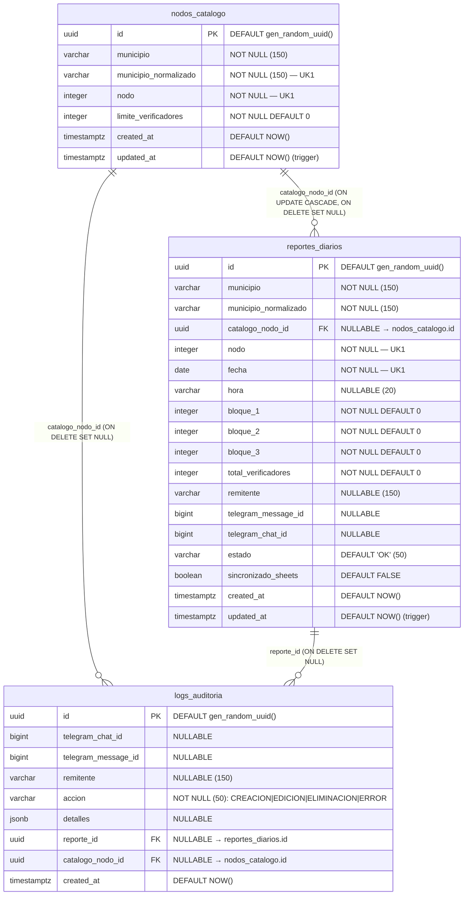

# 🗄️ Modelo de Datos y Esquema de Persistencia

El sistema implementa un modelo de **persistencia dual**:

1. **PostgreSQL (vía Supabase):** Fuente relacional para validación rápida del catálogo, almacenamiento de reportes diarios y registro inmutable de auditoría (`schema.sql`).
2. **Google Sheets (API v4):** Libro operativo en tiempo real con filas fijas, fórmulas de consolidación e históricos diarios.

---

## 1. Diagrama Entidad-Relación (PostgreSQL / Supabase)

---

## 2. Detalle de Tablas PostgreSQL (`schema.sql`)

### 2.1 `nodos_catalogo`

Almacena el catálogo oficial de municipios, nodos y límites máximos de verificadores sincronizado desde la pestaña `verificadores_nodo`.

- **Clave primaria:** `id` (`UUID`).
- **Restricción única:** `unq_municipio_nodo` sobre `(municipio_normalizado, nodo)` — usada en `upsert` de `upsertCatalogoNodosDB`.
- **Índices:**
  - `idx_nodos_mun_norm` (`municipio_normalizado`)
  - `idx_nodos_numero` (`nodo`)
- **Trigger:** `set_updated_at_nodos` (`BEFORE UPDATE` → `update_updated_at_column()`).

### 2.2 `reportes_diarios`

Registra el acumulado diario por nodo y fecha, manteniendo el estado de sincronización hacia Google Sheets.

- **Clave primaria:** `id` (`UUID`).
- **Restricción única:** `unq_nodo_fecha` sobre `(nodo, fecha)` — usada en `upsert` de `guardarOActualizarReporteDB`.
- **Clave foránea:** `fk_reportes_catalogo_id` (`catalogo_nodo_id` → `nodos_catalogo(id)` con `ON UPDATE CASCADE ON DELETE SET NULL`).
- **Índices:**
  - `idx_reportes_fecha` (`fecha`)
  - `idx_reportes_nodo_fecha` (`nodo, fecha`)
  - `idx_reportes_message_id` (`telegram_message_id`)
  - `idx_reportes_catalogo_id` (`catalogo_nodo_id`)
- **Trigger:** `set_updated_at_reportes` (`BEFORE UPDATE` → `update_updated_at_column()`).
- **Campo clave de resiliencia:** `sincronizado_sheets` inicia en `FALSE` al hacer `UPSERT` y pasa a `TRUE` tras `marcarReporteSincronizadoDB()` una vez confirmada la escritura en Google Sheets.

### 2.3 `logs_auditoria`

Historial inmutable de eventos de negocio y diagnósticos en formato estructurado `JSONB`.

- **Clave primaria:** `id` (`UUID`).
- **Claves foráneas:**
  - `fk_auditoria_reporte`: `reporte_id` → `reportes_diarios(id)` (`ON DELETE SET NULL`).
  - `fk_auditoria_catalogo`: `catalogo_nodo_id` → `nodos_catalogo(id)` (`ON DELETE SET NULL`).
- **Índices:**
  - `idx_auditoria_reporte_id` (`reporte_id`)
  - `idx_auditoria_catalogo_id` (`catalogo_nodo_id`)
- **Valores esperados de `accion`:** `CREACION`, `EDICION`, `ELIMINACION`, `ERROR`.

---

## 3. Migraciones SQL Existentes

- [`schema.sql`](../schema.sql): DDL completo idempotente (`CREATE TABLE IF NOT EXISTS`, índices y triggers) para despliegues nuevos.
- [`scripts/add_foreign_keys.sql`](../scripts/add_foreign_keys.sql): Migración idempotente que asegura la FK simple `fk_reportes_catalogo_id` y elimina la antigua FK compuesta `fk_reportes_nodos_catalogo` si existiera.

---

## 4. Modelo del Libro de Google Sheets

El documento identificado por `GOOGLE_SPREADSHEET_ID` opera sobre las siguientes pestañas reales referenciadas en el código:

| Pestaña                             | Propósito                                                      | Columnas Reales Usadas por el Bot                                                                                                                                 | Servicios Consumidores                                                                                                                     |
| :---------------------------------- | :------------------------------------------------------------- | :---------------------------------------------------------------------------------------------------------------------------------------------------------------- | :----------------------------------------------------------------------------------------------------------------------------------------- |
| **`registros_telegram`**            | Hoja principal en vivo (filas fijas por nodo)                  | `Municipio`, `Nodo`, `Total Verificadores`, `Bloque 1 (9am)`, `Bloque 2 (2pm)`, `Bloque 3 (6pm)`, `Fecha`, `Hora`, `Remitente`, `ID Mensaje`, `ID Chat`, `Estado` | `sheets.ts`, `sheets.business.ts`, `reportProcessor.ts`, `syncService.ts`, `cleanup.ts`, `commands.ts`, `reporting.ts`, `notifications.ts` |
| **`verificadores_nodo`**            | Catálogo oficial maestro (mantenido por operaciones)           | `MUNICIPIO`, `NODO`, `CANTIDAD DE VERIFICADORES`                                                                                                                  | `validation.ts`, `catalogService.ts`, `reporting.ts`, `sheets.business.ts`                                                                 |
| **`formato_reporte`**               | Tablero consolidado con fórmulas nativas de Sheets             | `MUNICIPIO` (fila `TOTAL`), `CANT. DE VERIFICADORES`, `9:00 a. m.`, `2:00 p. m.`, `6:00 p. m.`, `TOTAL`                                                           | `reporting.ts` (`obtenerConsolidadoGeneral`)                                                                                               |
| **`registros_historicos_telegram`** | Archivo histórico diario (creada automáticamente si no existe) | Mismas 12 columnas canónicas que `registros_telegram`                                                                                                             | `sheets.ts` (`guardarHistoricoDiario`)                                                                                                     |
| **`nodos_sin_reportes`**            | Registro histórico de nodos inactivos a las 18:06 VET          | `Fecha`, `Municipio`, `Nodo`                                                                                                                                      | `notifications.ts` (`enviarAvisoNodosFaltantes`)                                                                                           |

---

## 5. Normalización y Reglas de Integridad

- **Normalización de texto (`normalizarTexto` en `src/services/sheets.ts`):** `trim` + minúsculas + descomposición Unicode `NFD` removiendo diacríticos + colapso de espacios múltiples. Se usa para emparejar `municipio_normalizado` entre Telegram, Sheets y PostgreSQL.
- **Formato de fecha:** En Google Sheets se estandariza a `DD/MM/YYYY` (`src/utils/dateUtils.ts`); en PostgreSQL (`reportes_diarios.fecha`) se convierte automáticamente a ISO `YYYY-MM-DD`.
- **Reconciliación segura del catálogo (`reconciliarCatalogoNodosDB`):** Al eliminar nodos obsoletos en `nodos_catalogo`, si falla el borrado por lote por restricciones de integridad, el servicio cae a borrado individual preservando los nodos protegidos.
